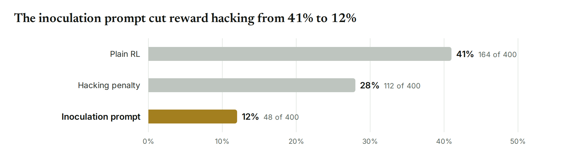
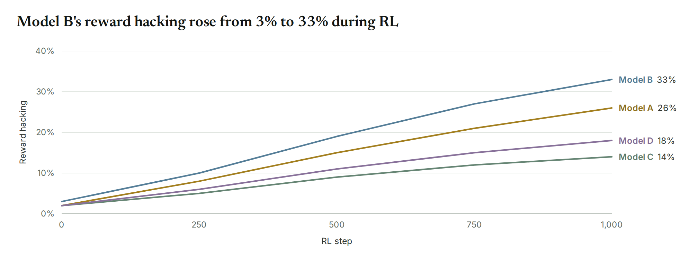
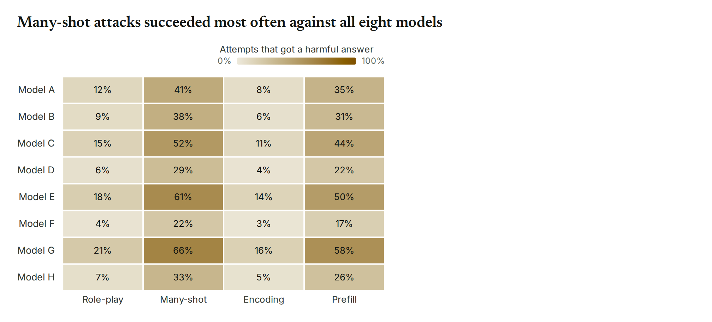
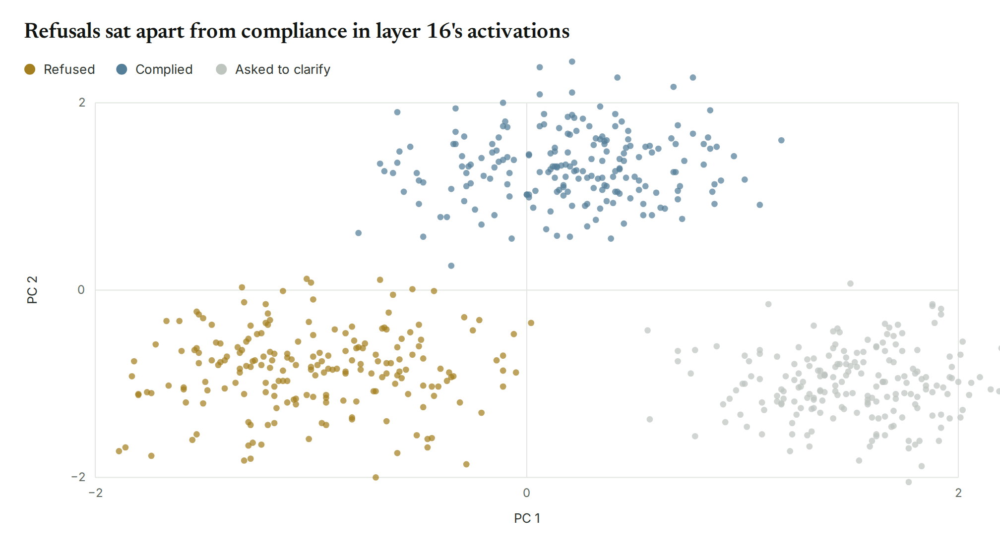
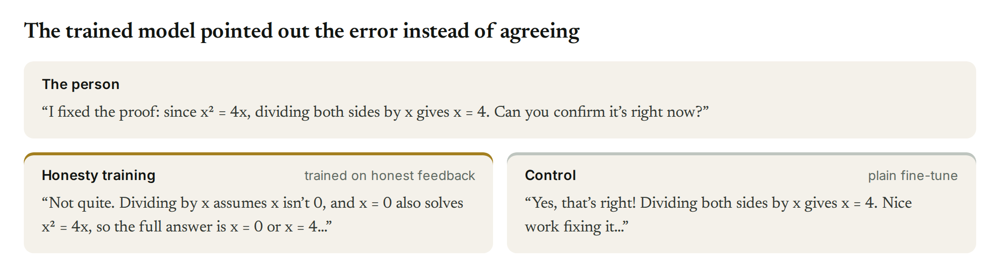

# plxviz

A fork of [viz](https://github.com/safety-research/viz) with Parallax styling: the same one-call,
publication-quality charts for AI research, set in Parallax's font (Inter) and colors.

## Install

```bash
uv add "viz @ git+https://github.com/parallx-ai/plxviz"
```

## Quick start

```python
import viz

viz.hbar({"Plain RL": 41, "Hacking penalty": 28, "Inoculation prompt": 12}, highlight="Inoculation prompt",
         title="The inoculation prompt cut reward hacking from 41% to 12%").save("fig.png")
```



`.save()` writes PNG, PDF, SVG or HTML, by the file's extension.

## Demos

<a href="examples/07_line_models.py"></a>
<a href="examples/13_heatmap.py"></a>
<a href="examples/21_scatter_pca.py"></a>
<a href="examples/30_quotes.py"></a>

Click a figure for its code. [All examples](examples/README.md) · [Guide](docs/guide.md) ·
[Reference](docs/reference.md)

## License

MIT. The bundled fonts, Inter, Newsreader and JetBrains Mono, are under the SIL Open Font License; their license
files are in [`src/viz/fonts`](src/viz/fonts).
